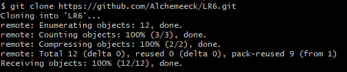
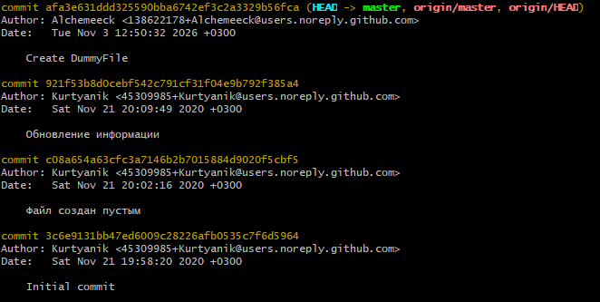
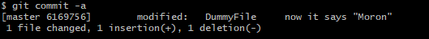
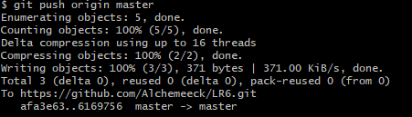
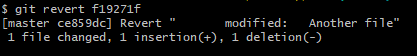

# Лабораторная работа №6
# Система контроля версий
Для клонирования репозитория использовалась команда `git clone` с указанием ссылки на репозиторий.  
  
Для просмотра истории коммитов использовалась команда `git log`  
  
Для фиксирования изменений использовалась команда `git commit -a`  
  
Для выгрузки изменений использовалась команда `git push origin master`  
  
Для отката коммита использовалась команда `git revert f19271f`, где f19271f - хеш откатываемого коммита  
  
Лог команд  
  
